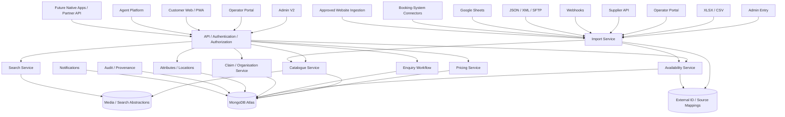

# Deeparture V2 - Complete Platform Architecture

**Architecture Source of Truth - Revision 1.0**  
**October 2026**

## 1. Purpose

This document defines the intended target-state architecture for Deeparture V2 across all six planned phases.

It is intended to give the development team enough context to make implementation decisions now without accidentally creating parallel systems that later need to be replaced.

The central architectural rule is:

> **Every user interface and every future data source should use the same core Deeparture domain services. Do not build a separate catalogue, pricing, availability, organisation, claim, enquiry or search system for each frontend or provider.**

The architecture should be extended phase by phase. Future integrations should normally be added as adapters around stable internal services rather than by redesigning the core.

---

# 2. Target-State Platform Overview

Deeparture V2 is a multi-sided travel platform serving four primary user experiences:

- Deeparture Admin
- Operators / suppliers
- Direct customers
- Agents / B2B partners

Future partner APIs, native applications and background workers should use the same backend/domain services wherever possible.

## High-level architecture

---

# 3. Architectural Principles

## 3.1 Stable internal identities

Deeparture entities use permanent internal IDs.

External supplier/provider IDs must be stored as mappings and must not replace Deeparture's primary identity.

The same vessel, resort, itinerary or departure may later be referenced by multiple external systems.

## 3.2 Shared domain services

Admin, Operator, Customer and Agent frontends must call the same backend/domain services for common business logic.

Examples:

- pricing calculation
- effective availability
- enquiry state changes
- claim handling
- catalogue validation
- attribute resolution
- search/filter logic

Do not duplicate business rules in individual frontends.

## 3.3 Adapter-based integrations

Each future supplier or external platform should be implemented as an adapter/connector.

Preferred pattern:

`external source -> adapter -> normalized Deeparture contract -> core service -> database`

Avoid:

`external source -> provider-specific database logic`

## 3.4 Versioning

Version:

- public APIs
- supplier APIs
- import schemas/templates
- webhook contracts
- connector contracts where appropriate

## 3.5 Idempotency

Imports, webhooks and synchronization jobs must tolerate retries without creating duplicate records.

## 3.6 Explicit workflow states

Publication, claims, enquiries, invitations, synchronization and similar workflows should use explicit states rather than combinations of loosely related boolean flags.

## 3.7 Provenance and auditability

Important data changes should be traceable to:

- actor or system
- source
- timestamp
- previous/new state where practical
- reason for manual overrides where relevant

## 3.8 Environment separation

Maintain separate development, staging and production environments.

Each phase sign-off should record the exact branch, commit and deployed environment.

---

# 4. Application / Experience Layer

## 4.1 Admin V2

Primary internal operational interface.

Responsibilities include:

- catalogue creation and moderation
- operator organisation management
- claim invitations
- structured attributes and locations
- imports
- enquiry review/approval
- availability management
- audit/provenance views
- source/integration monitoring in later phases

## 4.2 Operator Portal

Supplier self-service interface.

Operators maintain authorised data for the organisations and products they are linked to.

The Operator Portal should use the same catalogue, pricing, availability and import services as Admin.

## 4.3 Customer Web / PWA

Public marketplace interface.

Responsibilities include:

- search
- filtering
- product/detail pages
- itinerary/departure/package discovery
- pricing/offers
- availability
- enquiries/request-to-book

## 4.4 Agent Platform

B2B layer for approved agents/partners.

It should use the same inventory and domain services, with additional permissions and private commercial pricing where appropriate.

## 4.5 Future Native Apps / Partner API

Future applications should call versioned backend APIs rather than duplicating domain logic.

---

# 5. Identity, Organisations and Permissions

Core relationship:

`User -> Organisation -> Membership -> Role / Permissions`

An organisation may own or manage:

- liveaboards
- resorts
- both liveaboards and resorts

Users may eventually belong to more than one organisation.

Permissions should be capability-based rather than assuming a single permanent role.

Examples:

- catalogue.read
- catalogue.edit
- pricing.edit
- availability.edit
- enquiry.respond
- organisation.manage
- admin.moderate

Deeparture-only editorial fields, including verified/editorial vegan grading, remain protected from ordinary operator editing.

---

# 6. Core Domain Model

## 6.1 Shared entities

- User
- Organisation
- OrganisationMembership
- Location
- AttributeDefinition
- ProductAttribute
- MediaAsset
- AuditLog
- ExternalSource / Mapping
- Enquiry
- Claim / Invitation

## 6.2 Liveaboard domain

Primary relationship:

`Organisation -> Vessel -> Itinerary -> Departure`

Additional concepts:

- CabinType
- itinerary base pricing
- departure-specific pricing override
- offer/discount
- effective price
- availability
- destination/port references
- facilities/attributes

The vessel identity should remain separate from a temporary operator relationship wherever possible so a future management/operator change does not require recreating the vessel.

## 6.3 Resort domain

Primary relationship:

`Organisation -> Resort -> RoomType -> Package -> Rate Period / Availability`

Resorts remain structurally separate from liveaboards because they do not naturally use fixed-departure logic.

Additional concepts:

- seasonal/rate-period pricing
- room/package combinations
- availability
- offers
- facilities/attributes
- destination references

---

# 7. Pricing Architecture

## Liveaboard pricing

Preferred layering:

`Itinerary base price -> optional departure override -> active offer/discount -> effective price`

## Resort pricing

Preferred layering:

`Package / room base or rate-period price -> optional override -> active offer/discount -> effective price`

## Currency handling

Store:

- native supplier currency
- native amount
- pricing basis
- optional normalized/search currency and value

The normalized/search currency is for comparison/filtering and must not replace the original supplier price.

Future architecture should allow additional price layers such as:

- published price
- net/agent rate
- commission
- contracted rate
- customer-facing promotional price

These later commercial layers should extend the pricing model rather than require a separate agent inventory model.

---

# 8. Availability Architecture

Deeparture uses one source-independent **Normalized Availability Service**.

All availability updates should eventually flow through this service.

## Sources

Current/near-term:

- Admin/manual entry
- XLSX/CSV imports
- Operator Portal

Future:

- Supplier API
- webhooks
- JSON/XML/SFTP
- Google Sheets
- booking-system connectors
- approved external data feeds
- approved website ingestion

## Normalized availability contract

A normalized update should be able to represent:

- internal/external product identity
- product type
- vessel or resort
- departure / stay / package context
- optional cabin or room type
- status
- optional quantity
- source type
- source reference/provider
- sourceUpdatedAt
- receivedAt

Suggested status values:

- unknown
- available
- limited
- sold_out
- on_request

## Resolution

Public/search consumers should receive **effective/resolved availability**.

They should not need to know whether the value came from Admin, XLSX, API, webhook or connector.

Later source-management logic can add:

- source priority
- freshness thresholds
- conflict resolution
- manual override
- override expiry
- history

Important rule:

> Stale availability is not the same as sold out.

And:

> A value is not automatically "live availability" simply because an availability field exists.

---

# 9. Catalogue Import Architecture

Deeparture uses one normalized catalogue ingestion path.

Preferred pattern:

`source -> source adapter -> normalized import DTO/schema -> validation -> matching -> preview -> confirmation -> catalogue service -> database`

## Initial sources

- XLSX
- CSV
- Admin forms

## Future sources

- Operator spreadsheet mappings
- Supplier API
- Google Sheets
- JSON/XML/SFTP
- booking-system connectors
- approved website extraction

## Import rules

- parsers/adapters do not write directly to MongoDB
- normalize source-specific fields before core validation
- preview before commit
- identify CREATE / UPDATE / DUPLICATE_REVIEW / ERROR-SKIP
- use stable IDs/upsert keys
- preserve provenance/source metadata
- allow future schema/template versioning

---

# 10. Search and Filtering Architecture

Search/filtering is a major architectural requirement.

The system should support many simultaneous filter variables without schema redesign each time a new specialist filter is added.

Use a **hybrid model**:

## 10.1 First-class structured filter fields

Use dedicated structured fields/references for high-value search dimensions such as:

- product type
- country
- region
- destination
- departure port
- arrival port
- departure date
- date range
- trip duration
- effective price
- currency-normalized search price
- availability
- organisation/operator
- capacity where appropriate

These should be optimized for database/API-level filtering.

## 10.2 Extensible typed attributes

Use the attribute system for specialist criteria that may grow over time.

Examples:

- vegan grade
- vegan/plant-based support
- dietary options
- accessibility support
- technical diving support
- rebreather support
- nitrox
- sidemount support
- photography facilities
- camera room
- charging facilities
- Wi-Fi
- certification requirements
- minimum logged dives
- mobility assistance
- tender accessibility

Attributes should support appropriate types rather than forcing every value into a boolean.

Recommended attribute types include:

- boolean
- number
- controlled single-select / enum
- controlled multi-select
- short text only where filtering does not require stronger typing

Each attribute definition can include metadata such as:

- code
- label
- group/category
- value type
- filterable
- public
- applicable product types
- sort/order
- allowed values where relevant

## 10.3 Example future filter query

A customer should ultimately be able to ask for:

`Raja Ampat + January 2027 + under USD 4,000 + Vegan Grade 4/5 + Nitrox + available`

without requiring a schema rewrite.

## 10.4 Frontend filter rendering

Phase 4 should be capable of using attribute definitions to drive appropriate filter controls dynamically.

For example:

- boolean -> checkbox
- enum -> select/checklist
- number -> numeric/range control
- multi-select -> checkbox group

This reduces the need to manually hard-code every future specialist filter.

---

# 11. Locations and Geography

Locations should be canonical entities, not uncontrolled repeated strings.

Possible hierarchy:

`Country -> Region -> Destination -> Port`

Examples:

`Egypt -> Red Sea -> Southern Red Sea -> Port Ghalib`

`Indonesia -> Raja Ampat -> Dampier Strait -> Sorong`

Catalogue and itinerary/departure records should reference location IDs.

Aliases/spelling variants should resolve to canonical entities rather than creating duplicate search filters.

---

# 12. Enquiry Workflow

Deeparture retains an Admin-first enquiry workflow.

Target flow:

`Customer submits -> customer acknowledgement -> Admin review -> Admin approves -> Operator receives -> Operator responds -> Admin/customer confirmation`

Important rule:

> A new customer enquiry should not be sent directly to an operator before Admin review.

The workflow should use explicit states so invalid transitions can be rejected.

Potential states may include:

- pending_admin_review
- approved_for_operator
- sent_to_operator
- operator_responded
- confirmed
- rejected
- spam
- closed

Exact names may evolve, but the state machine principle should remain.

---

# 13. Claiming and Catalogue-First Ownership

Deeparture follows a **catalogue-first, claim-later** model.

Target process:

`Deeparture creates/imports Organisation + Vessel/Resort -> listing can exist unclaimed -> operator is invited -> operator claims existing organisation/listing -> operator maintains authorised data`

Claiming must not create duplicate organisations or duplicate vessels/resorts.

Claim tokens should remain:

- hashed
- expiring
- single-use

---

# 14. Audit, Provenance and Verification

Audit/provenance should be implemented as reusable platform services.

Important events include:

- listing created/updated
- publication state changed
- import committed
- enquiry state changed
- claim completed
- availability updated
- manual override applied/expired
- source/integration state changed

Future verification controls can record:

- verifiedBy
- verifiedAt
- source/provenance
- lastCheckedAt
- confidence/review status where appropriate

---

# 15. Notifications

Notifications should be treated as a service boundary.

Channels may include:

- email
- in-app Admin notifications
- in-app Operator notifications
- future webhook/system notifications

Business events should trigger notifications without embedding email-specific logic throughout domain code.

---

# 16. Background Jobs and Event Readiness

The architecture should remain ready for asynchronous work.

Examples:

- scheduled supplier sync
- stale-source checks
- email delivery
- webhook retries
- image processing
- search indexing
- exchange-rate refresh
- import processing
- integration health monitoring

Internal events may include:

- listing.published
- listing.updated
- availability.updated
- price.updated
- enquiry.created
- enquiry.approved
- claim.completed
- organisation.claimed
- import.completed

A full event bus is not required immediately, but service boundaries should not make it difficult to introduce background workers later.

---

# 17. External Integration Layer

Phase 5 introduces the **Deeparture Supply Network & Data Automation** layer.

Potential sources:

- Deeparture Supplier API
- booking-system APIs
- external liveaboard feeds
- resort feeds
- webhooks
- Google Sheets
- JSON
- XML
- SFTP
- approved website ingestion

A provider such as sharc, if connected later, should be implemented as a connector/adapter:

`sharc -> Sharc adapter -> normalized Deeparture catalogue/availability service`

Deeparture must not depend on one external provider for its core data model.

---

# 18. Media and Search Abstraction

## Media

Keep media references abstracted from a specific storage provider so future storage/CDN changes do not require catalogue redesign.

## Search

Initial search may use MongoDB querying/indexes.

The application should keep search logic behind a service boundary so a future dedicated search engine can be introduced without rewriting all frontends.

---

# 19. Security and Secrets

- secrets are not stored in catalogue records
- credentials are not committed to source control
- environment-specific secrets use deployment secret management
- organisation ownership is enforced on backend routes
- Admin routes require Admin capabilities
- provider/webhook authentication should be explicit
- future webhooks should support signature validation/replay protection
- rate limiting should be applied where appropriate
- audit logs should not store passwords or raw claim tokens

---

# 20. Deployment Architecture

Current platform direction:

- GitHub - source control
- Render - frontend/backend staging deployment
- MongoDB Atlas - V2 staging database
- production environment to remain separate from staging

## Deployment identity requirement

For every phase acceptance, record:

- Git branch
- exact deployed commit hash
- frontend URL
- backend/API URL
- database/environment
- acceptance-test status
- any deployment-specific changes
- known issues/exceptions

The deployment should explicitly confirm:

> "This commit is the version currently deployed to the Deeparture V2 Render staging environment."

---

# 21. Phase Mapping

## Phase 1 - Foundation & Staging

Implemented/foundation:

- standalone V2 architecture
- auth
- organisations/memberships
- vessel/resort foundations
- itinerary/departure/package foundations
- pricing
- initial availability
- automatic public pages
- search foundations
- claiming foundations
- enquiry/email foundations
- staging/CI foundations

## Phase 2A - Core Admin V2

Primary focus:

- operational Admin V2
- catalogue moderation
- draft/pending review
- organization management
- claim invitations
- locations
- attributes
- normalized catalogue import
- normalized availability write boundary
- Admin-first enquiry workflow
- responsive Admin UI

## Phase 2B - Admin Automation & Management

Adds:

- import history
- duplicate reconciliation
- in-app notifications
- audit/provenance UI
- claim history
- verification/completeness
- website-source review queue
- availability freshness/source priority/conflicts
- overrides/history
- advanced Admin operations/reporting

## Phase 3 - Operator Portal V2

Adds:

- supplier self-service
- authorised catalogue management
- pricing/offers
- availability updates
- media
- enquiry response
- organisation membership/roles
- operator imports

Uses the same core services created in earlier phases.

## Phase 4 - Customer Frontend V2 + PWA

Adds:

- polished customer marketplace
- full faceted search/filter UI
- dynamic detail pages
- customer enquiry/request flow
- SEO
- PWA

## Phase 5 - Deeparture Supply Network & Data Automation

Adds:

- Supplier API
- webhooks
- connector framework/SDK
- booking-system integrations
- scheduled feeds
- source mappings
- integration monitoring
- Google Sheets / JSON / XML / SFTP / website ingestion

## Phase 6 - Agent Platform

Adds:

- agency organisations/users
- B2B search
- agent/private pricing layers
- enquiries/quotes/bookings
- reporting
- future partner distribution/API capabilities

---

# 22. Current Development Priority

The immediate implementation sequence remains:

`Phase 1 baseline -> Phase 2A -> Phase 2B -> Phase 3 -> Phase 4 -> Phase 5 -> Phase 6`

Although Phase 2 is split into 2A and 2B operationally, it remains one of the six primary project phases.

The development team should not start a later phase by bypassing or duplicating a shared service established in an earlier phase.

---

# 23. Non-Negotiable "Do Not" Rules

Do not:

- create a separate availability model/service for each provider
- create a separate pricing engine for Admin, Customer, Operator or Agent
- let spreadsheet parsers write directly into MongoDB
- use provider IDs as Deeparture primary IDs
- create duplicate organisations/listings during claiming
- store important searchable geography as uncontrolled free text
- hard-code every future specialist filter as a new schema field
- force every attribute into a yes/no boolean
- call stale/manual availability "live" without source/freshness semantics
- send new customer enquiries directly to operators before Admin approval
- rebuild working Phase 1/2 services when a new interface can reuse them

---

# 24. Architectural Test

A future feature is probably designed correctly if it can be added as:

`new interface or source -> existing/versioned API or adapter -> shared domain service -> existing core model`

rather than:

`new feature -> new parallel database logic`

This is the architectural standard that should guide upcoming phases.
